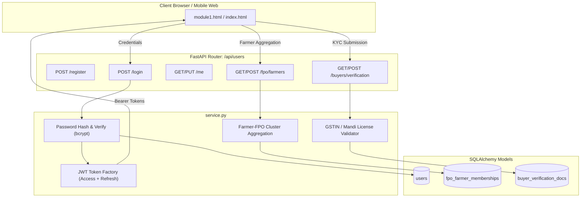

# Module 01: User & Role Management

## 1. Purpose and SIH26132 Requirement
Module 01 addresses the core foundational requirement of **Smart India Hackathon SIH26132** (Govt. of Maharashtra): establishing authenticated, role-based identities for all agricultural market participants. By distinguishing between individual **Farmers**, **FPOs (Farmer Producer Organizations)**, **Institutional Buyers**, and **Government/Admin Officers**, the platform enforces regulatory compliance, prevents predatory anonymous intermediary trading, enables collective bargaining via FPO clusters, and provides localized interfaces in Marathi, Hindi, and English.

---

## 2. Technologies Used and Why
- **FastAPI**: Asynchronous, standards-compliant REST API framework with native OpenAPI doc generation and high throughput.
- **SQLAlchemy 2.0 & SQLite**: Modern ORM mapped declarative schema; database agnostic for seamless migration to PostgreSQL.
- **Pydantic v2**: Strict, high-performance request/response data validation and serialization.
- **bcrypt**: Industry-standard cryptographic salt + hash mechanism resistant to GPU-accelerated rainbow-table attacks.
- **PyJWT**: Secure, stateless JSON Web Tokens for stateless access token (short-lived) and refresh token (long-lived) lifecycle.
- **Vanilla ES Modules & CSS3**: Zero-dependency client-side UI guaranteeing instantaneous loading on low-bandwidth rural mobile networks.

---

## 3. Folder/File Structure
```
Module_01_User_Roles/
├── __init__.py               # Python package initialization
├── README.md                 # Complete 12-point module technical specification
├── backend/
│   ├── __init__.py           # Re-exports models and router for main backend integration
│   ├── models.py             # SQLAlchemy entities: User, FPOFarmerMembership, BuyerVerificationDoc
│   ├── schemas.py            # Pydantic v2 request/response validation schemas
│   ├── service.py            # Business logic: registration, authentication, token issuance, FPO roster, KYC
│   └── router.py             # APIRouter mounted at /api/users
├── frontend/
│   ├── module1.html          # Profile settings, FPO roster, Buyer KYC & user directory view
│   ├── module1.css           # Responsive styling for profile forms and verification badges
│   └── module1.js           # Client controller consuming /api/users endpoints
└── tests/
    └── test_module1.py       # Pytest suite verifying auth, RBAC, FPO aggregation, and KYC verification
```

---

## 4. Architecture & Data Flow


---

## 5. Database Tables & Relations

### Table: `users`
| Column | Type | Constraints | Description |
|---|---|---|---|
| `id` | Integer | PK, Index | Unique internal user ID |
| `email` | String(120) | Unique, Index, Not Null | Primary user login handle |
| `phone` | String(20) | Index, Nullable | Contact mobile number |
| `hashed_password`| String(255) | Not Null | Bcrypt hashed password string |
| `full_name` | String(100) | Not Null | Legal entity or individual name |
| `role` | String(20) | Not Null | `Farmer`, `FPO`, `Buyer`, `Admin` |
| `district` | String(60) | Not Null | Maharashtra district (e.g., Nashik, Pune) |
| `state` | String(60) | Default 'Maharashtra' | State jurisdiction |
| `taluka` | String(60) | Nullable | Sub-district or Taluka |
| `preferred_lang` | String(10) | Default 'en' | `en`, `hi`, `mr` |
| `is_active` | Boolean | Default True | Account operational flag |
| `created_at` | DateTime | Default UTC now | Registration timestamp |

### Table: `fpo_farmer_memberships`
| Column | Type | Constraints | Description |
|---|---|---|---|
| `id` | Integer | PK | Membership identifier |
| `fpo_id` | Integer | FK (`users.id`), Not Null | Reference to the FPO parent user |
| `farmer_id` | Integer | FK (`users.id`), Not Null | Reference to the individual farmer user |
| `land_size_acres`| Float | Default 2.5 | Farmer's cultivable land in acres |
| `primary_crop` | String(50) | Default 'Onion' | Main crop grown by member |
| `status` | String(20) | Default 'active' | Membership status |
| `joined_at` | DateTime | Default UTC now | Enrollment date |

### Table: `buyer_verification_docs`
| Column | Type | Constraints | Description |
|---|---|---|---|
| `id` | Integer | PK | Document record identifier |
| `buyer_id` | Integer | FK (`users.id`), Unique, Not Null | Reference to the institutional buyer |
| `company_name` | String(120)| Not Null | Registered company or trade name |
| `gstin` | String(20) | Not Null | 15-character GSTIN |
| `mandi_license_no`| String(50) | Not Null | APMC mandi market trader license number |
| `status` | String(20) | Default 'pending' | `pending`, `verified`, `rejected` |
| `verification_remarks`| Text | Default remarks | Audit notes from registrar |
| `verified_at` | DateTime | Nullable | Verification timestamp |
| `created_at` | DateTime | Default UTC now | Submission timestamp |

---

## 6. API Endpoints

| Method | Path | Request Body | Response | Role Required | Description |
|---|---|---|---|---|---|
| `POST` | `/api/users/register` | `UserCreate` | `UserResponse` (201) | None | New user registration |
| `POST` | `/api/users/login` | `UserLogin` | `TokenResponse` (200) | None | Credential authentication |
| `POST` | `/api/users/refresh` | `RefreshTokenRequest` | `TokenResponse` (200) | None | Token refresh renewal |
| `GET` | `/api/users/me` | None | `UserResponse` (200) | Any Authenticated | Retrieve active user profile |
| `PUT` | `/api/users/me` | `UserUpdate` | `UserResponse` (200) | Any Authenticated | Update user district/language |
| `GET` | `/api/users/fpo/farmers`| None | `List[FPOMembershipResponse]` | `FPO`, `Admin` | List enrolled farmer members |
| `POST` | `/api/users/fpo/farmers`| `FPOAddFarmerRequest` | `FPOMembershipResponse` | `FPO`, `Admin` | Enroll farmer into FPO cluster |
| `GET` | `/api/users/buyers/verification` | None | `BuyerVerificationResponse` | `Buyer`, `Admin` | View KYC audit status |
| `POST` | `/api/users/buyers/verification` | `BuyerVerificationRequest` | `BuyerVerificationResponse` | `Buyer`, `Admin` | Submit GSTIN & mandi license |
| `POST` | `/api/users/admin/verify-buyer/{id}` | `AdminVerifyBuyerAction` | `BuyerVerificationResponse` | `Admin` | Officer KYC approval |
| `GET` | `/api/users/directory` | Query: `role`, `district` | `List[UserResponse]` | Any Authenticated | Directory search |

---

## 7. Step-by-Step Working & Security Algorithms
1. **Password Protection**: Passwords are never stored in plaintext. `bcrypt.hashpw(password, salt)` produces a 60-character salted hash with 12 computation rounds.
2. **Stateless JWT Claims**:
   - Access tokens have an expiration of 120 minutes with claims: `{ "sub": user.id, "email": user.email, "role": user.role, "district": user.district, "type": "access" }`.
   - Refresh tokens have a validity of 7 days: `{ "sub": user.id, "type": "refresh" }`.
3. **Role-Based Access Control (RBAC)**: The `require_role(*roles)` dependency decodes the Bearer token in the HTTP `Authorization` header, verifies expiration and signature against `SECRET_KEY`, loads the user from SQLite, and validates that `user.role` matches one of the authorized roles.
4. **Buyer KYC Validation**: Validates 15-character alphanumeric GSTIN formatting (e.g. `27` state code for Maharashtra) and cross-checks presence of APMC trader license.

---

## 8. Frontend Pages and User Flow
1. **Landing & Login (`/`)**: Select 1-click persona (Ramesh Patil - Farmer, Sahyadri - FPO, BigBasket - Buyer, Agri Officer - Admin) or register new credentials.
2. **Dashboard (`/dashboard`)**: Redirects to role-tailored workspace with localized greeting and direct navigation pills.
3. **User Management (`/modules/module-01/module1.html`)**:
   - Tab 1: Profile information & district/language switcher.
   - Tab 2 (FPO/Admin): Member Farmer Roster showing acreages, crops, and aggregate potential.
   - Tab 3 (Buyer/Admin): Institutional Buyer KYC verification state with APMC license check.
   - Tab 4: Directory of market participants across Maharashtra.

---

## 9. Connections with Other Modules
- **Reused by all Modules (M2 - M13)**: Supplies `require_role`, `get_current_user`, and `User` model for authorization and ownership across lots, offers, transactions, and disputes.
- **Feeds M4 (Produce Listing)**: Provides `farmer_id` and FPO membership to enable aggregate bulk lot creation with proportional farmer payouts.
- **Feeds M8 (Buyer Trust)**: Provides buyer KYC verification status (`verified` / `pending`) as an essential baseline criterion for the 0-100 reliability score.
- **Feeds M13 (Admin Analytics)**: Supplies demographic and role distribution metrics (count of registered farmers, active FPOs, verified buyers by district).

---

## 10. Sample Data and How to Seed
Execute the master seed script:
```bash
python backend/seed.py
```
This populates:
- **Farmer**: `ramesh@farmer.in` (Password: `farmer123`) - Nashik Onion farmer
- **FPO**: `sahyadri@fpo.in` (Password: `fpo123`) - Sahyadri Kisan Producer Co Ltd
- **Buyer**: `sourcing@bigbasket.com` (Password: `buyer123`) - Verified buyer
- **Admin**: `admin@mandisetu.gov.in` (Password: `admin123`) - State Agri Officer

---

## 11. How to Run Tests and Expected Results
Execute the dedicated pytest suite:
```bash
./venv/bin/pytest Module_01_User_Roles/tests/test_module1.py -v
```
Expected output:
```
Module_01_User_Roles/tests/test_module1.py::test_password_hashing PASSED
Module_01_User_Roles/tests/test_module1.py::test_user_registration PASSED
Module_01_User_Roles/tests/test_module1.py::test_duplicate_registration_fails PASSED
Module_01_User_Roles/tests/test_module1.py::test_authentication_and_tokens PASSED
Module_01_User_Roles/tests/test_module1.py::test_update_profile PASSED
Module_01_User_Roles/tests/test_module1.py::test_fpo_farmer_membership PASSED
Module_01_User_Roles/tests/test_module1.py::test_buyer_verification PASSED
7 passed in 0.xx s
```

---

## 12. Limitations, Mocked Parts and Future Improvements
- **Mocked APMC Registry**: Live integration with Maharashtra State Agricultural Marketing Board (MSAMB) API is simulated via a pattern and checksum validator for GSTIN and license codes.
- **SMS OTP Gateway**: Mobile phone numbers are verified via database records; production deployment should integrate CDAC/Govt. SMS Seva gateway.
